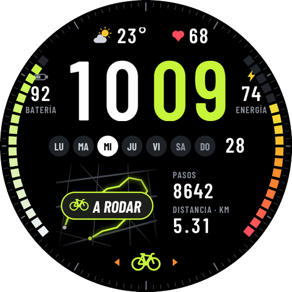

# Ruta Bici · esfera para Amazfit T-Rex 3



Esfera deportiva para ciclismo (480×480, Zepp OS):

- Hora grande: horas en blanco y minutos en verde lima.
- **Barra izquierda:** batería, segmentada (se pone naranja y roja cuando baja).
- **Barra derecha:** BioCharge (HybridCharge), con degradado de rojo a lima.
- Tiempo con icono, temperatura y pulso arriba.
- Días de la semana en español (LU MA MI JU VI SA DO) y día del mes.
- Pasos y distancia del día.
- Botón **A RODAR** y logo de la bici: abren directamente *Ciclismo exterior*.
- Zonas táctiles: tiempo, pulso, pasos y BioCharge abren su app.
- Aviso cuando se pierde el Bluetooth.
- Modo pantalla siempre activa (AOD): hora atenuada, día y bici.

El mapa es decorativo: Zepp OS no deja a las esferas leer las rutas GPS ni el tipo de entrenamiento.

## Instalar

1. En la app Zepp: **Perfil → Ajustes → Acerca de** y toca 7 veces el logo para activar el modo desarrollador.
2. **Perfil → T-Rex 3 → Modo desarrollador →** icono de escanear (arriba a la derecha).
3. Escanea `instalar/qr.png`.

## Recompilar

```bash
python3 herramientas/generar_assets.py   # imágenes, vista previa y disposicion.js
zeus build -t trex3                       # crea dist/*.zab (dentro va el .zpk)
python3 herramientas/generar_qr.py <url pública del .zpk>
```

Tipografía: Barlow Condensed (SIL OFL, ver `herramientas/fuentes/OFL.txt`).
